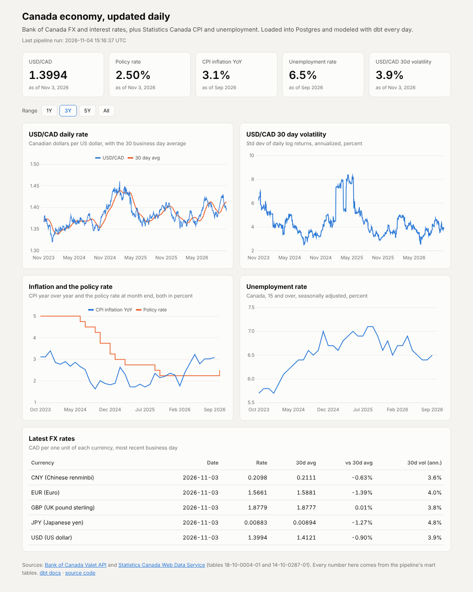
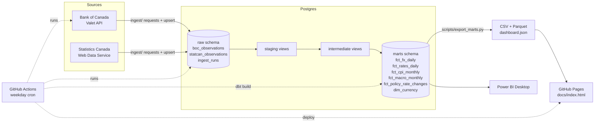

# canada-econ-pipeline

A daily ELT pipeline on free Canadian public data. Python loads Bank of Canada and Statistics Canada
data into PostgreSQL, dbt models it into marts, and GitHub Actions runs the whole thing on a schedule
and publishes a small dashboard to GitHub Pages.

I rebuilt this in 2026 on public data, as a small pipeline that runs on its own every weekday.



Live dashboard: https://mayank-thite.github.io/canada-econ-pipeline/ (the screenshot is from a local
run on 2026-11-04).

## What the data says

I wanted the dashboard to answer two questions, not just draw lines.

**Is the policy rate above or below inflation?** In September 2026 CPI was up 3.09% on a year
earlier and the policy rate ended the month at 2.25%, so the real policy rate was -0.84 points. The
Bank raised to 2.50% effective October 29, 2026. The real rate here is backward looking (policy rate
minus the last 12 months of inflation), which is the simple version, not the one economists argue
about.

**Does the Canadian dollar move when the rate changes?** Not much more than usual. The policy rate
changed 28 times between July 2017 and October 2026. Over a window from two business days before
each change to one day after, the median USD/CAD move was 0.44%. The median for the same window on
any day was 0.41%, and the median rate change ranked at the 53rd percentile of all windows. The
direction did follow the textbook 20 times out of 28 (a hike followed by a stronger CAD, a cut by a
weaker one). If direction were a coin flip, 20 or more out of 28 would happen about 2% of the time,
but 28 events is a small sample and most of these changes were priced in before the announcement.
I read it as "the direction lines up, the size is ordinary". It is not a causal estimate.

One thing I only noticed while building this: series V39079 shows the new rate on the day it takes
effect. Since 2022 that is the day after the announcement, so a window that starts on the effective
date would miss the reaction. That is why the window starts two business days earlier.

## What it does

- **Extract and load (Python).** Pulls 7 daily Bank of Canada series (USD, EUR, GBP, JPY and CNY
  against CAD, the policy rate and CORRA) and 2 monthly Statistics Canada series (all-items CPI and
  the unemployment rate). Requests retry with backoff. Bank of Canada loads are incremental by last
  loaded date with a 7 day look-back. Statistics Canada is pulled in full every run (see Revisions
  below). Every write is an upsert, so re-running is safe.
- **Transform (dbt on Postgres).** Staging views clean and type the raw rows. Intermediate views add
  daily log returns and monthly rollups. Mart tables hold daily FX with rolling averages and
  volatility, monthly CPI with inflation, daily rates, one combined monthly macro table, and one row
  per policy rate change with the USD/CAD move around it.
- **Test.** 72 dbt data tests (not null, unique, relationships, accepted values, accepted ranges,
  no gaps in monthly series, and two singular checks), source freshness checks per series, and 22
  pytest tests. 20 run offline on recorded API responses and small hand-made frames, and 2 run
  against Postgres when one is reachable.
- **Orchestrate (GitHub Actions).** A weekday cron starts a Postgres service container, runs ingestion,
  checks freshness, runs `dbt build`, exports the marts to CSV and Parquet as a build artifact, and
  deploys the dashboard and dbt docs to GitHub Pages. A separate CI workflow lints and tests every PR.
- **Use.** A static HTML dashboard (Chart.js) and a Power BI guide with DAX measures.

## Architecture



## Run it locally

You need Python 3.12 or newer, Docker, and `make`.

```bash
git clone https://github.com/mayank-thite/canada-econ-pipeline.git
cd canada-econ-pipeline
make all
```

`make all` creates a virtualenv, installs the pinned requirements, starts Postgres with
`docker compose` (or uses one that is already answering on `PGHOST:PGPORT`), loads the data, runs
`dbt build`, and exports the marts. On my machine the whole thing took under a minute, most of it
the pip install. If you point it at a Postgres you already run, it needs an `econ` role and database
(or set the `PG*` variables in `.env`).
Then:

```bash
make dashboard   # serves docs/ on http://localhost:8000
make docs        # dbt docs as one static HTML file in docs/dbt/
make test        # pytest
make lint        # ruff and sqlfluff
make freshness   # dbt source freshness
```

Connection settings come from `.env` if it exists (see `.env.example`). The defaults are
`econ` / `econ` on `localhost:5432`. If port 5432 is taken, run `make all PGPORT=5433`.

### Layout

```
ingest/              extract and load (config, http retries, BoC and StatCan parsers, Postgres upserts)
transform/           dbt project (staging, intermediate, marts, seeds, custom tests, exposures)
scripts/             export of marts to CSV, Parquet and the dashboard JSON
tests/               pytest, with recorded API fixtures in tests/fixtures/
docs/                dashboard (index.html), Power BI guide, DAX measures
data/marts/          last exported mart files from my local run
.github/workflows/   daily pipeline and CI
```

## Schedule

`.github/workflows/daily-pipeline.yml` runs at 22:30 UTC Monday to Friday (5:30 pm EST, 6:30 pm
EDT). The Bank of Canada posts each business day's FX rates around 4:30 pm ET, and Statistics
Canada releases at 8:30 am ET, so the run picks up both on the same day. I dropped the weekend runs
because neither source publishes then. It can also be started by hand from the Actions tab.

The run job only gets `contents: read` and `pages: read`. Only the deploy job can write to Pages.
Every action is pinned to a commit SHA, and a concurrency group stops two runs from deploying at once.

Each Actions run starts from an empty Postgres service container, so in CI the load is a full load.
It is small (about 17,500 rows) and takes a few seconds. The incremental logic matters for a
database that persists, like the Docker one: a second local run only pulls the last 7 days of
Bank of Canada data.

## Data dictionary

All marts are in the `marts` schema. Row counts are from my local run on 2026-11-04.

### `fct_fx_daily` (12,270 rows)

One row per currency per business day since 2017-01-03.

| Column | Type | Description |
|---|---|---|
| currency_code | text | USD, EUR, GBP, JPY or CNY |
| rate_date | date | Business day |
| cad_per_unit | numeric | Canadian dollars per one unit of the currency (Bank of Canada daily average) |
| daily_change_pct | numeric | Log return from the previous business day, times 100 |
| rolling_avg_7d | numeric | Average of the last 7 business days, null until 7 exist |
| rolling_avg_30d | numeric | Average of the last 30 business days, null until 30 exist |
| volatility_30d_annualized_pct | numeric | Std dev of the last 30 daily log returns, times sqrt(252), in percent |

### `fct_rates_daily` (2,555 rows)

| Column | Type | Description |
|---|---|---|
| rate_date | date | Business day |
| policy_rate_pct | numeric | Target for the overnight rate (series V39079) |
| corra_pct | numeric | Canadian Overnight Repo Rate Average (series AVG.INTWO) |

### `fct_cpi_monthly` (129 rows)

| Column | Type | Description |
|---|---|---|
| month | date | First day of the reference month, from 2016-01 |
| cpi_index | numeric | All-items CPI, 2002 = 100, not seasonally adjusted (table 18-10-0004-01) |
| inflation_mom_pct | numeric | Change from the previous month |
| inflation_yoy_pct | numeric | Change from the same month a year earlier |
| release_time | timestamp | When Statistics Canada published the value |

### `fct_macro_monthly` (118 rows)

One row per month from 2017-01 to the last complete month of FX data.

| Column | Type | Description |
|---|---|---|
| month | date | First day of the month |
| cpi_index | numeric | All-items CPI |
| inflation_yoy_pct | numeric | CPI inflation, year over year |
| unemployment_rate_pct | numeric | Unemployment rate, Canada, 15 years and over, all genders, seasonally adjusted (LFS table 14-10-0287-01, vector v2062815) |
| policy_rate_eom_pct | numeric | Policy rate on the last business day of the month |
| corra_avg_pct | numeric | Average CORRA over the month |
| real_policy_rate_pct | numeric | Month end policy rate minus CPI inflation YoY (backward looking) |
| usdcad_avg | numeric | Average USD/CAD over the month |
| usdcad_eom | numeric | USD/CAD on the last business day of the month |

CPI and unemployment come out 5 to 7 weeks after the month ends, so the latest month or two have
nulls in those columns. That is expected.

### `fct_policy_rate_changes` (28 rows)

One row per change in the policy rate since 2017. Holds are not in here, because V39079 only shows
the rate, not decision dates.

| Column | Type | Description |
|---|---|---|
| effective_date | date | First business day V39079 shows the new rate |
| previous_rate_pct, new_rate_pct | numeric | Rate before and after |
| change_bps | int | Size of the change, negative for a cut |
| direction | text | hike or cut |
| window_start, window_end | date | Two business days before, one business day after |
| usdcad_start, usdcad_end | numeric | USD/CAD at each end of the window |
| usdcad_change_pct | numeric | Log change over the window times 100. Positive means CAD got weaker |
| abs_move_percentile | numeric | Rank of the move's size among the same window on every day, 0 to 100 |
| median_abs_move_all_days_pct | numeric | Benchmark: median size of that window across all days |
| cad_moved_textbook_direction | boolean | Hike then stronger CAD, or cut then weaker CAD |

### `dim_currency` (5 rows)

| Column | Type | Description |
|---|---|---|
| currency_code | text | ISO 4217 code |
| currency_name | text | Name |
| boc_series_id | text | Valet series id, like FXUSDCAD |
| first_rate_date, last_rate_date | date | Date range loaded |
| n_observations | bigint | Business days with a rate |

## Data quality and failure handling

**An API is down or slow.** Every request retries up to 4 times with exponential backoff on
timeouts, 429 and 5xx responses. If a source still fails, the loader rolls back that source, writes
a `failed` row with the error to `raw.ingest_runs`, carries on with the other source, and exits with
code 1. In Actions that fails the run, nothing is deployed, and the last good dashboard stays up.
GitHub emails me about the failed run.

**Late data.** dbt source freshness runs before the build. Bank of Canada data warns after 4 days
and errors after 7. A normal weekend is a 3 day gap and Christmas can make it close to 5, so that
gives a warning at worst. Freshness is measured from the observation date, not the load time, so a
source that answers but stops adding rows is still caught.

Statistics Canada freshness is checked per vector. I first had one check on the whole table, and
then realised the LFS comes out about two weeks before CPI, so a CPI series that had stopped loading
would never have tripped it. CPI warns after 90 days and errors after 120 (the newest month can be
about 82 days old right before a release). Unemployment warns after 75 and errors after 105. A
freshness error stops the run, which also means a stuck Statistics Canada feed holds back the FX
update. I chose that on purpose so the dashboard never shows a half updated picture.

On top of that, `assert_boc_series_not_stale` warns if any one Bank of Canada series falls more than
3 days behind the others. CORRA is published the next morning, so a 1 day lag is normal.

**Revisions.** The Bank of Canada part re-pulls the last 7 days and upserts them, so a corrected
value replaces the old one. For Statistics Canada I started with a 3 month look-back, but the LFS
seasonally adjusted series gets revised every January going back three years, and a short window
would keep the old numbers forever in a database that persists. Two monthly vectors since 2016 are
about 260 rows, so now the loader just pulls the full history every run. In Actions this never
mattered, since the database starts empty each run, but it did for the local Docker database. A
pytest test checks the upsert overwrites a revised value, and another checks the Statistics Canada
load never starts from a watermark. A value Statistics Canada deletes outright would stay in my
table; I have not handled that.

**Schema change.** The parsers check the shape of each response and raise a `SchemaError` if
`observations`, `seriesDetail` or the date key is missing, a value is not numeric, a requested
series is not returned, or a Statistics Canada vector comes back with a status other than SUCCESS.
pytest covers each of these cases with edited copies of the recorded fixtures. If something slips
through the parser, the dbt tests catch it at the model level:

- `accepted_range` on FX rates, interest rates, CPI, unemployment, daily moves (within 10 percent)
  and volatility. A unit change, like a rate suddenly quoted in basis points, fails these.
- `assert_policy_rate_in_quarter_points` fails if the policy rate is ever off the 0.25 point grid
  the Bank of Canada uses.
- `unique_combination` and `unique` on every grain, `relationships` from facts to `dim_currency`,
  and `no_month_gaps` on every monthly model.

## Power BI

See [docs/powerbi.md](docs/powerbi.md) for how to connect Power BI Desktop to the marts, and
[docs/measures.dax](docs/measures.dax) for the measures.

## Tools and versions

PostgreSQL 16, Python 3.13, dbt-core 1.12.6 with dbt-postgres 1.11.0, pandas, pyarrow, requests,
pytest, ruff, sqlfluff, Chart.js 4.4.1, GitHub Actions. All Python packages are pinned in
`requirements.txt` and `requirements-dev.txt`.

I wrote the generic tests (`accepted_range`, `unique_combination`, `no_month_gaps`) as small macros in
`transform/tests/generic/` instead of pulling in dbt_utils, so the dbt project has no package
dependencies.

## Limitations

- Only 9 series. Adding more is a line in `ingest/config.py` plus a staging model.
- The Actions database is thrown away after each run. The marts are kept as a build artifact for
  30 days and the dashboard JSON is published to Pages, but there is no long-lived warehouse.
  Pointing `PGHOST` at a hosted Postgres would fix that.
- The dashboard shows USD/CAD only on the charts. The other currencies are in the table and the
  mart files.
- GitHub turns off scheduled workflows in a repo with no commits for 60 days. If the dashboard stops
  updating, that is the first thing to check, and re-enabling it in the Actions tab fixes it.
- The rate change analysis has 28 events, three of them in March 2020. I would not put much weight
  on any single bar.
- CPI is not seasonally adjusted, so `inflation_mom_pct` has a seasonal pattern. Year over year is
  the number to look at.
- Freshness thresholds are based on normal release timing. A long holiday or a delayed Statistics
  Canada release can trigger a warning that is not a real problem.
- The Power BI file itself is not in the repo, only the connection steps and measures.

## Data sources and terms

- Bank of Canada Valet API: https://www.bankofcanada.ca/valet/docs. See the Bank's terms of use at
  https://www.bankofcanada.ca/terms/.
- Statistics Canada Web Data Service: https://www.statcan.gc.ca/en/developers/wds. Data is used
  under the Statistics Canada Open Licence.

## Problems I ran into

- **Freshness checks that couldn't fail.** I first checked Statistics Canada freshness on the whole table. The labour force survey comes out about two weeks before CPI, so a stalled CPI feed would never have tripped it. Each series now has its own freshness check.
- **Revisions.** StatCan revises past CPI and LFS values, and the January LFS revision goes back three years. A 3 month look-back missed that, so the StatCan pull is now a full reload every run. It's only about 260 rows.
- **Rate decisions vs effective dates.** The policy rate series shows the new rate on its effective date, which since 2022 is the day after the announcement. The rate change window starts two business days early so the market move isn't missed.
- **No dbt packages.** `dbt deps` couldn't reach GitHub from my build machine, so I wrote three small generic tests (`accepted_range`, `unique_combination`, `no_month_gaps`) instead of pulling in dbt_utils.
- **Workflow permissions.** The first version gave the whole workflow Pages write access. Now only the deploy job can write, and every action is pinned to a commit.

## License

MIT. See [LICENSE](LICENSE).
