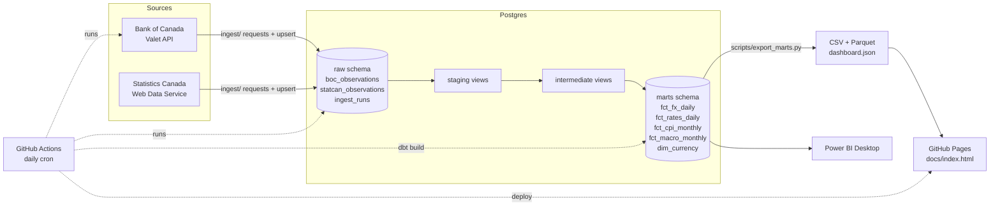

# canada-econ-pipeline

A daily ELT pipeline on free Canadian public data. Python loads Bank of Canada and Statistics Canada
data into PostgreSQL, dbt models it into marts, and GitHub Actions runs the whole thing on a schedule
and publishes a small dashboard to GitHub Pages.

Built in 2026 to run on its own every day.


The screenshot is from a local run on 2026-11-04. The live version is at
https://mayank-thite.github.io/canada-econ-pipeline/ once Pages is turned on for the repo.

## What it does

- **Extract and load (Python).** Pulls 7 daily Bank of Canada series (USD, EUR, GBP, JPY and CNY
  against CAD, the policy rate and CORRA) and 2 monthly Statistics Canada series (all-items CPI and
  the unemployment rate). Requests retry with backoff. Loads are incremental by last loaded date, with
  a small look-back window to catch revisions, and every write is an upsert, so re-running is safe.
- **Transform (dbt on Postgres).** Staging views clean and type the raw rows. Intermediate views add
  daily log returns and monthly rollups. Mart tables hold daily FX with rolling averages and
  volatility, monthly CPI with inflation, daily rates, and one combined monthly macro table.
- **Test.** 65 dbt data tests (not null, unique, relationships, accepted values, accepted ranges,
  no gaps in monthly series, and two singular checks), source freshness checks, and 21 pytest tests
  that run offline on recorded API responses.
- **Orchestrate (GitHub Actions).** A daily cron starts a Postgres service container, runs ingestion,
  checks freshness, runs `dbt build`, exports the marts to CSV and Parquet as a build artifact, and
  deploys the dashboard and dbt docs to GitHub Pages. A separate CI workflow lints and tests every PR.
- **Use.** A static HTML dashboard (Chart.js) and a Power BI guide with DAX measures.

## Architecture



## Run it locally

You need Python 3.12 or newer, Docker, and `make`.

```bash
git clone https://github.com/mayank-thite/canada-econ-pipeline.git
cd canada-econ-pipeline
make all
```

`make all` creates a virtualenv, installs the pinned requirements, starts Postgres with
`docker compose` (or uses one that is already answering on `PGHOST:PGPORT`), loads the data, runs
`dbt build`, and exports the marts. A first run takes about 20 seconds after the install.
Then:

```bash
make dashboard   # serves docs/ on http://localhost:8000
make docs        # dbt docs as one static HTML file in docs/dbt/
make test        # pytest
make lint        # ruff and sqlfluff
make freshness   # dbt source freshness
```

Connection settings come from `.env` if it exists (see `.env.example`). The defaults are
`econ` / `econ` on `localhost:5432`. If port 5432 is taken, run `make all PGPORT=5433`.

### Layout

```
ingest/              extract and load (config, http retries, BoC and StatCan parsers, Postgres upserts)
transform/           dbt project (staging, intermediate, marts, seeds, custom tests, exposures)
scripts/             export of marts to CSV, Parquet and the dashboard JSON
tests/               pytest, with recorded API fixtures in tests/fixtures/
docs/                dashboard (index.html), Power BI guide, DAX measures
data/marts/          last exported mart files from my local run
.github/workflows/   daily pipeline and CI
```

## Schedule

`.github/workflows/daily-pipeline.yml` runs at 22:30 UTC every day (5:30 pm EST, 6:30 pm EDT).
The Bank of Canada posts each business day's FX rates around 4:30 pm ET, so the run picks up the
same day's numbers. It can also be started by hand from the Actions tab.

Each Actions run starts from an empty Postgres service container, so in CI the load is a full load.
It is small (about 17,500 rows) and takes a few seconds. The incremental logic matters for a
database that persists, like the Docker one: a second local run only pulls the last 7 days of
Bank of Canada data and the last 3 months of Statistics Canada data.

## Data dictionary

All marts are in the `marts` schema. Row counts are from my local run on 2026-11-04.

### `fct_fx_daily` (12,270 rows)

One row per currency per business day since 2017-01-03.

| Column | Type | Description |
|---|---|---|
| currency_code | text | USD, EUR, GBP, JPY or CNY |
| rate_date | date | Business day |
| cad_per_unit | numeric | Canadian dollars per one unit of the currency (Bank of Canada daily average) |
| daily_change_pct | numeric | Log return from the previous business day, times 100 |
| rolling_avg_7d | numeric | Average of the last 7 business days, null until 7 exist |
| rolling_avg_30d | numeric | Average of the last 30 business days, null until 30 exist |
| volatility_30d_annualized_pct | numeric | Std dev of the last 30 daily log returns, times sqrt(252), in percent |

### `fct_rates_daily` (2,555 rows)

| Column | Type | Description |
|---|---|---|
| rate_date | date | Business day |
| policy_rate_pct | numeric | Target for the overnight rate (series V39079) |
| corra_pct | numeric | Canadian Overnight Repo Rate Average (series AVG.INTWO) |

### `fct_cpi_monthly` (129 rows)

| Column | Type | Description |
|---|---|---|
| month | date | First day of the reference month, from 2016-01 |
| cpi_index | numeric | All-items CPI, 2002 = 100, not seasonally adjusted (table 18-10-0004-01) |
| inflation_mom_pct | numeric | Change from the previous month |
| inflation_yoy_pct | numeric | Change from the same month a year earlier |
| release_time | timestamp | When Statistics Canada published the value |

### `fct_macro_monthly` (118 rows)

One row per month from 2017-01 to the last complete month of FX data.

| Column | Type | Description |
|---|---|---|
| month | date | First day of the month |
| cpi_index | numeric | All-items CPI |
| inflation_yoy_pct | numeric | CPI inflation, year over year |
| unemployment_rate_pct | numeric | Unemployment rate, 15 and over, seasonally adjusted (table 14-10-0287-01) |
| policy_rate_eom_pct | numeric | Policy rate on the last business day of the month |
| corra_avg_pct | numeric | Average CORRA over the month |
| real_policy_rate_pct | numeric | Policy rate minus CPI inflation |
| usdcad_avg | numeric | Average USD/CAD over the month |
| usdcad_eom | numeric | USD/CAD on the last business day of the month |

CPI and unemployment come out 5 to 7 weeks after the month ends, so the latest month or two have
nulls in those columns. That is expected.

### `dim_currency` (5 rows)

| Column | Type | Description |
|---|---|---|
| currency_code | text | ISO 4217 code |
| currency_name | text | Name |
| boc_series_id | text | Valet series id, like FXUSDCAD |
| first_rate_date, last_rate_date | date | Date range loaded |
| n_observations | bigint | Business days with a rate |

## Data quality and failure handling

**An API is down or slow.** Every request retries up to 4 times with exponential backoff on
timeouts, 429 and 5xx responses. If a source still fails, the loader rolls back that source, writes
a `failed` row with the error to `raw.ingest_runs`, carries on with the other source, and exits with
code 1. In Actions that fails the run, nothing is deployed, and the last good dashboard stays up.
GitHub emails me about the failed run.

**Late data.** dbt source freshness runs before the build. Bank of Canada data warns after 4 days
and errors after 7 (weekends and holidays make 3 to 4 day gaps normal). Statistics Canada data warns
after 80 days and errors after 110, since a monthly figure is normally 5 to 7 weeks behind. A
freshness error stops the run. On top of that, the `assert_fx_not_stale` test warns if one currency
stops updating while the others continue.

**Revisions.** Each incremental run re-pulls the last 7 days (Bank of Canada) and 3 months
(Statistics Canada) and upserts them, so a revised value replaces the old one. There is a pytest
test for this against Postgres.

**Schema change.** The parsers check the shape of each response and raise a `SchemaError` if
`observations`, `seriesDetail` or the date key is missing, a value is not numeric, a requested
series is not returned, or a Statistics Canada vector comes back with a status other than SUCCESS.
pytest covers each of these cases with edited copies of the recorded fixtures. If something slips
through the parser, the dbt tests catch it at the model level:

- `accepted_range` on FX rates, interest rates, CPI, unemployment, daily moves (within 10 percent)
  and volatility. A unit change, like a rate suddenly quoted in basis points, fails these.
- `assert_policy_rate_in_quarter_points` fails if the policy rate is ever off the 0.25 point grid
  the Bank of Canada uses.
- `unique_combination` and `unique` on every grain, `relationships` from facts to `dim_currency`,
  and `no_month_gaps` on every monthly model.

## Power BI

See [docs/powerbi.md](docs/powerbi.md) for how to connect Power BI Desktop to the marts, and
[docs/measures.dax](docs/measures.dax) for the measures.

## Tools and versions

PostgreSQL 16, Python 3.13, dbt-core 1.12.6 with dbt-postgres 1.11.0, pandas, pyarrow, requests,
pytest, ruff, sqlfluff, Chart.js 4.4.1, GitHub Actions. All Python packages are pinned in
`requirements.txt` and `requirements-dev.txt`.

I wrote the generic tests (`accepted_range`, `unique_combination`, `no_month_gaps`) as small macros in
`transform/tests/generic/` instead of pulling in dbt_utils, so the dbt project has no package
dependencies.

## Limitations

- Only 9 series. Adding more is a line in `ingest/config.py` plus a staging model.
- The Actions database is thrown away after each run. The marts are kept as a build artifact for
  30 days and the dashboard JSON is published to Pages, but there is no long-lived warehouse.
  Pointing `PGHOST` at a hosted Postgres would fix that.
- The dashboard shows USD/CAD only on the charts. The other currencies are in the table and the
  mart files.
- CPI is not seasonally adjusted, so `inflation_mom_pct` has a seasonal pattern. Year over year is
  the number to look at.
- Freshness thresholds are based on normal release timing. A long holiday or a delayed Statistics
  Canada release can trigger a warning that is not a real problem.
- The Power BI file itself is not in the repo, only the connection steps and measures.

## Data sources and terms

- Bank of Canada Valet API: https://www.bankofcanada.ca/valet/docs. See the Bank's terms of use at
  https://www.bankofcanada.ca/terms/.
- Statistics Canada Web Data Service: https://www.statcan.gc.ca/en/developers/wds. Data is used
  under the Statistics Canada Open Licence.

## License

MIT. See [LICENSE](LICENSE).
